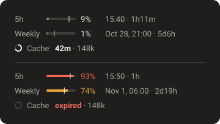

<div align="center">


# usage-limits

### Your Claude limits, right above the prompt.

5-hour and weekly usage, exact reset times and a prompt cache countdown, in the terminal and the desktop app.

[](https://github.com/anthropics/claude-code) [](LICENSE)


</div>

## Install

At the prompt of a terminal session:

```
/plugin install usage-limits --marketplace qsang793/claude-usage-limits
```

From a shell:

```bash
claude plugin install usage-limits --marketplace qsang793/claude-usage-limits
```

This adds the marketplace and installs the plugin for your user, with no questions. The row appears in every session started afterwards, including the desktop app's Code tab. A session already open keeps the version it loaded until you run `/reload-plugins` in it (the desktop app too); the numbers still refresh there meanwhile.

In the desktop app, where `/plugin` does not run: click + next to the prompt box, then Plugins, Add marketplace with `qsang793/claude-usage-limits`, then Add plugin.

Requires Claude Code 2.1.304 or newer.

> [!NOTE]
> The limits exist only on a Claude subscription (Pro, Max, Team, Enterprise). With an API key there is nothing to show and the row stays hidden.

## Reading the row

In a terminal:

```
5h █░░░░░░░░░ 9% · Nov 1, 01:00 · 2h26m   Weekly █░░░░░░░░░ 12% · Nov 5, 21:00 · 4d22h   ● Cache 60m · 44k
```

| Part | Meaning |
| --- | --- |
| `█░░░` bar | How much of the window you have used. Yellow from 25% once you are at or ahead of an even pace, so the window would run out before its reset (at 70% if the reset time is unknown). Red at 90%. |
| `Nov 1, 01:00 · 2h26m` | When it resets, with the date when that is not today, then how long until then. |
| `●` ring | The share of this conversation's prompt cache lifetime that is left. It empties as the cache runs out. |
| `60m` | Minutes until the cache expires, counted from its last reply. Yellow in the last 10 minutes (the last minute of a 5-minute cache), then `expired` in red. |
| `44k` | The context the next message would have to process again once the cache has expired. |

In the desktop app the row is drawn as SVG and each track also has a tick marking how much of the window has gone by. A bar past its tick is using the window faster than an even pace, which is what turns it yellow. This illustration uses sample values, on pace and then near the limit:

<p align="center"></p>

Asking after the cache expires costs that whole context again, so it is the moment to `/compact` or start a new session before stepping away.

### The cache countdown

- The TTL is the one Claude Code picks: 1 hour on a subscription, unless `FORCE_PROMPT_CACHING_5M`, `CLAUDE_CODE_PROMPT_CACHE_TTL` or `promptCacheTtl` in `settings.json` under `CLAUDE_CONFIG_DIR` (`~/.claude` by default) say otherwise.
- Subagents' own caches are not counted, and the column appears after the conversation's first reply.

### How it behaves

- **Account-wide, refreshed while idle.** Every 2 minutes the mod asks Anthropic's usage endpoint (the one the app's own "Plan usage limits" panel reflects), once for all your open sessions, and after each reply it also takes the engine's own reading.
- **Instant in a new session.** A new session shows the last known reading right away (the engine only learns the limits after the first reply); a window whose reset time has passed is hidden until the next reading.
- **Follows the login.** A `/login` during a session counts from the next poll, so after switching subscription accounts the row can show the previous account's numbers for about 2 minutes, or longer if the usage endpoint is unreachable.
- **Desktop and terminal.** A crisp SVG row in the Claude desktop app, a text bar in a terminal.
- **Localized.** On macOS the dates and the cache column's words follow the Claude desktop app's language (Settings → Language), for example `Bộ đệm` and `hết hạn` in Vietnamese; elsewhere they are in English.
- **Keeps other bands.** It shares the slot with other bands (for example the ponytail band) instead of replacing them. Which one is on top follows the order Claude Code loads plugins in, so it can differ between machines; in the desktop app they are spaced apart either way.

## Privacy

The session's own login is used through the engine (`$.session.authorize`): the token never reaches the mod, and nothing is read from the Keychain.

The usage endpoint is undocumented. If it is unreachable or changes, the row falls back to the engine's readings.

## Update

New versions do not arrive on their own, because auto-update is off by default for third-party marketplaces. To turn it on, run `/plugin` in a session, open the Marketplaces tab, select this marketplace, then Enable auto-update.

To update once instead, select this marketplace in the same tab, then Update marketplace. From a shell, refresh the marketplace first, because the second command only compares against the local copy of its listing and otherwise reports the old version as the latest:

```bash
claude plugin marketplace update usage-limits
```

```bash
claude plugin update usage-limits@usage-limits
```

A session already open keeps the version it loaded until you run `/reload-plugins`; new sessions load the update.

## Uninstall

```bash
claude plugin uninstall usage-limits
```

## Develop

`claude plugin validate .` checks the mod, `claude plugin test .` runs `usage.test.tsx`.

To run a checkout as your mod, so a `git pull` is the whole update on every machine:

```bash
git clone https://github.com/qsang793/claude-usage-limits.git ~/claude-usage-limits
```

```bash
ln -s ~/claude-usage-limits ~/.claude/mods/usage-limits
```

Sessions started afterwards load the new code; one already open picks it up with `/reload-plugins`.

To release, bump `version` in `.claude-plugin/plugin.json`: installed copies only see an update when that string changes.

## License

[MIT](LICENSE)
